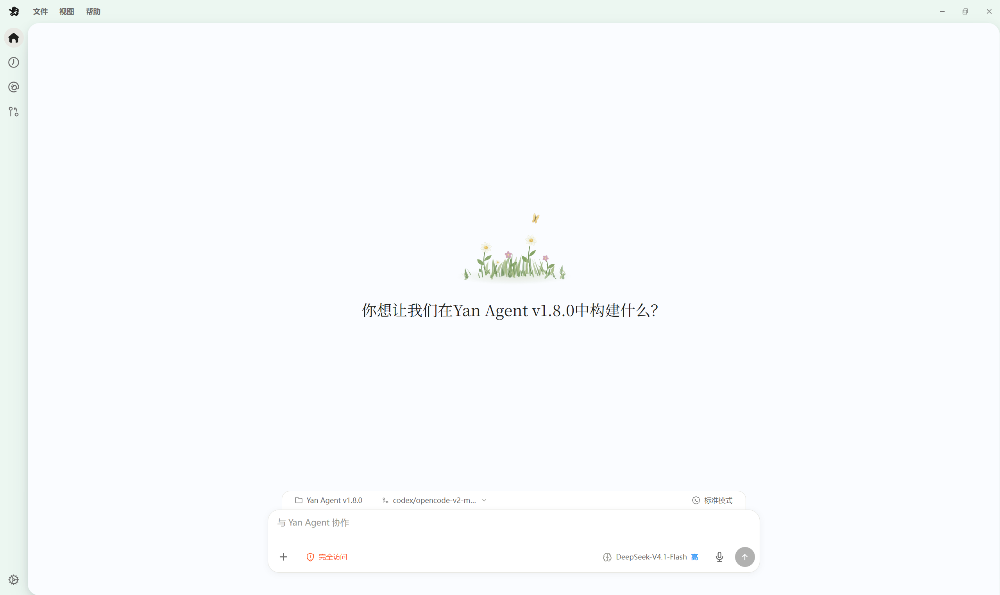

<div align="center">

# Yan Agent

### The best way to build with agents

**From understanding a project to changing, running and verifying it — hand engineering work to an AI workspace that actually acts.**

[中文](README.md) · [English](README.en.md)

[](https://github.com/ViaTumLab/Yan-Agent/releases)

[](LICENSE)

[Download for Windows](https://github.com/ViaTumLab/Yan-Agent/releases) · [Releases](https://github.com/ViaTumLab/Yan-Agent/releases) · [Issues](https://github.com/ViaTumLab/Yan-Agent/issues) · [Website](https://yanagent.top)

</div>



Yan Agent is an open-source Windows desktop AI agent. You bring the goal, the project and a model service; it reads files, traces problems, edits code, runs commands and verifies results inside the real workspace using browsers, tests and desktop tools.

v1.8.0 moves the runtime to **Yan Kernel V2** and adds agent modes, nested sessions, dynamic workflow orchestration and scheduled tasks. Projects, conversations, subagents, browser, diffs and tool runs still revolve around one task: you can follow progress, add requirements and inspect deliverables at any time.

## What's new in v1.8.0

| Capability | Details |
| --- | --- |
| Yan Kernel V2 | A private Node kernel with rewritten startup, cancellation, shutdown and process cleanup; tasks read, modify and verify directly in the workspace. |
| Agent modes | Standard, Minimal, Creative, Daily and Uncensored, plus saved custom agents, switchable when starting a task. |
| Nested sessions | Up to 4 child sessions inside one task, with human-in-the-loop collaboration, per-child models and acceptance by the main session. |
| Dynamic workflows | Organize multi-stage work by goal, members, stages and tasks; dependencies unlock only after acceptance, with pause and resume. |
| Scheduled tasks | Run recurring work automatically in a dedicated conversation on a daily or weekly schedule. |
| System title bar | Sidebar toggle, File / View / Help menus and window controls in one bar. |
| Two browser acceptance levels | Quick runs one batched check; Rigorous covers multiple viewports, interactions and before/after frames. |
| Work-process rendering | Usage updates per turn, context components and goal progress refresh live, and tool runs end with natural prose. |

## What can you hand to Yan?

| Your goal | How Yan works |
| --- | --- |
| Fix a hard-to-reproduce bug | Read the project and logs, trace the call path, propose and implement a fix, then run the relevant tests. |
| Build a feature in an existing project | Understand project conventions, split frontend and backend work, change code and check integration. |
| Turn a design into a working page | Implement the page with design and frontend tools, then check interactions and screen sizes in the browser. |
| Review a batch of changes | Read diffs and context, point out concrete issues, answer review questions and keep iterating. |
| Tidy up content in desktop apps | Operate Windows apps after authorization, using app snapshots to understand the current screen. |
| Keep a long task moving | Review existing progress and file changes, adjust the plan, add context and continue. |
| Let work run on schedule | Create scheduled tasks for reminders, checks or recurring work at a set time. |

These scenarios combine: one task can change code, start a local preview, check a page, organize results and deliver files. Available tools depend on enabled plugins, model capabilities and your authorization.

## Handle engineering work efficiently

From elusive bugs and cross-module changes to new features, Yan works inside the actual project. The workspace provides file and project context, the terminal runs commands and tests, and the review panel shows what changed.

- **Understand first:** find files and symbols, map module relationships, trace implementation paths.
- **Implement in place:** edit files, run dev commands and respond to execution feedback.
- **Verify with real results:** check outcomes through tests, browser actions and screenshots.
- **Stay involved:** steer or queue messages while a task runs, and correct course early.

For example:

> Fix the bug where refreshing the page after login logs the user out. Trace frontend session restore and backend auth first, keep the existing UI, then verify login, refresh, logout and wrong-password paths, and tell me which files changed.

## Five agent modes for different work

The mode menu above the composer decides which system prompt and tool set a task uses. The choice is saved with the task; switching the menu does not change a task that is already running.

| Mode | Best for |
| --- | --- |
| Standard | Full development environment with all tools; the default. |
| Minimal | Very little context and very few exposed tools; useful for playground tests. |
| Creative | Create plugins, skills, pets or custom agents and personalize Yan Agent. |
| Daily | Everyday chat, web search, image and video generation; switch back to Standard for development. |
| Uncensored | Uncensored system prompt with all tools; responsibility rests with the user. |

When you need a fixed configuration, create and save a **custom agent**; it appears in the same menu for later tasks. Agent modes change prompts and available tools — read/write, network and approval boundaries still come from permission settings.

## One task, four ways to collaborate

Yan offers four complementary ways to divide work; combine them as complexity grows.

### Nested sessions

Split one task into subtasks and create up to **4 child sessions**. Children support human-in-the-loop conversation and can use different models; you and the main session accept the combined result.

### Subagents

The main agent creates and names subagents as needed. They inherit its permissions and run up to 10 concurrently. The subagent panel shows each subagent's name, current action and elapsed time; it shows the pending count and lets you cancel selected subagents. Subagents have no preset roles — their responsibilities come from the dispatch.

### Dynamic workflow orchestration

For multi-stage work, the main agent registers a goal, members, stages and tasks, then advances in dependency order. The "workflow orchestration" panel lists tasks and owners per stage, with states for pending, running, awaiting review, accepted, completed, needs attention, interrupted and paused.

Dependent tasks unlock only after their upstream task is explicitly accepted. Every submitted task is reviewed — accept it, or request rework with concrete evidence. Write scopes coordinate task boundaries; they do not grant extra permissions.

### External desktop agents

Yan connects to desktop agents such as **Codex** and **Claude**. Inspect details in the agent catalog, detect local programs, configure paths, then dispatch tasks and collect results. App login, directory trust and the external app's own approvals remain in your hands.

## Scheduled tasks: work that happens on time

Scheduled tasks let Yan run recurring work at a set time. Creation has three pages: **Description** for what each run should do, **When** for workspace, daily or weekly frequency and time, and **Model** for the model and reasoning level of that task.

- Each scheduled task has its own conversation and runs once when due.
- Chatting in that conversation is a manual follow-up; it does not trigger another scheduled run.
- Reminder tasks output a single reminder; tasks needing facts, checks or actions actually perform them and report results.

## From diffs to pull requests

Before committing you need more than "done": you need scope, rationale and verification.

- Inspect the file tree and code diffs to see actual changes.
- Add review comments and send feedback back into the task.
- Manage branches, commits and worktrees alongside the task.
- Handle PRs and issues, with review and Q&A around the change.
- Archive managed worktrees with their results and restore them later.

## Browser and computer use, beyond the terminal

### Built-in browser

Web pages join the task workflow directly. Open a local preview or a live page, sign in, check forms, test interactions and verify both wide and narrow layouts.

Browser acceptance has two levels: **Quick** runs one batched check and asks for approval to upgrade on high-risk pages such as 3D/WebGL, login or payment; **Rigorous** covers multiple viewports, interactions and before/after frames. Tabs can be reused or dragged into a separate window, and the browser also provides history, downloads, page annotations and PDF export.

### Windows app control

Let Yan operate desktop apps within the permissions you grant. Manage always-allowed apps, review apps it has controlled and the experience it accumulated, and download that experience as a **Markdown file** for reading, backup or sharing.

### App snapshots

When describing a screen is hard, show it. Configure a shortcut, capture the external app window, then attach the screenshot, app info and your question to the chat; you can also read the text in a snapshot.

## Put tools, skills and services in one place

Extensions consist of **plugins, agents, skills and MCP**. Install, configure, enable or disable them so tasks get the methods and tools they need.

- **Plugins:** install professional capabilities, read details and examples, connect required accounts, and check for updates from the "Details" side.
- **Skills:** use built-in working methods or import skill directories from other agents, maintained by link or copy.
- **Project rules:** give the agent code conventions, build steps and project boundaries; global preferences live in custom instructions.
- **MCP:** connect local or remote tool services and load tools and context on demand.

Common extensions include Figma, Canva, Playwright, Remotion and HyperFrames, covering design, browser automation and video production. The new **Magpie-for-Yan-Agent** plugin brings your subscriptions into Yan Agent.

### Ten built-in services

Yan ships these services; you do not need to install them as third-party MCP servers. Some are not connected by default and activate on demand.

| Service | Responsibility |
| --- | --- |
| Yan Skills | Find, install, list, read and remove skills and skill resources. |
| Yan Built-in Browser | Drive the right-side browser for reading, interaction and visual acceptance. |
| Yan Web | Read known URLs as text, save static assets and fetch page resources. |
| Yan Session | Authorized cross-task/workspace handoff, external agent collaboration and Intelligent UI. |
| Yan Continual Harness | Queue repeated failures and reusable tactics for evidence-based refinement after a turn. |
| Yan Analysis | Repository maps, symbol outlines, call trees and BM25 code/history search. |
| Yan Workspace | Task-level git worktrees and code_impact reverse dependency analysis. |
| Yan MCP | Verify official sources, then install, verify and remove MCP servers. |
| Yan Plugin | Browse, validate and install Yan plugins. |
| Yan Provider | Probe a provider's model catalog, write the connection and bind text/image/video models. |

## Choose your own models

Yan supports multiple connections and provider paths, including OpenAI, Anthropic, Gemini, DeepSeek, Qwen, GLM and Kimi. Pick models per task, assign a model to nested sessions, and manage context, reasoning and output parameters.

- **Per-task models:** different tasks can use different models.
- **One-sentence provider setup:** give a Base URL, API key and model names; Yan probes the catalog and writes the connection.
- **Unified connections:** configure endpoint, protocol, API key and enabled models.
- **Multimodal chains:** configure text, image and video services for tasks with visual context.
- **Visible usage:** the usage component updates per turn with the latest request's context and usage estimate.

Model lists, tool calling, context length and media generation depend on the actual service. Yan Agent is open source; models and third-party services bill under their own terms.

## Everyday experience beyond code

Image viewing and editing support zoom, annotations, text and comments; voice input and read-aloud add options for input and reading. Chats can be renamed, pinned, archived, quoted and exported, and key artifacts open directly from links.

v1.8.0 also brings a new system title bar, the capsule panel, a startup animation, a confetti easter egg, auto-archiving of inactive chats and clearer blue-dot notifications. Configure fonts, sizes, themes, wallpapers, sounds and notifications to suit long sessions. Memory can be toggled per conversation or managed in settings.

### Leave the desk, keep managing tasks

Through the **LAN WebUI**, a phone or another device can follow and manage desktop tasks. Both ends must be on the same LAN, with the Yan host powered on, online and serving.

## Start with your first task

1. **Install:** download the Windows x64 installer from [Releases](https://github.com/ViaTumLab/Yan-Agent/releases) and launch it.
2. **Connect a model:** add endpoint, API key and protocol in model services, refresh and enable models.
3. **Choose a workspace:** open a project folder, or start from Blank (Blank supports full disk writes, still governed by sandbox, permissions and approvals).
4. **Pick an agent mode:** Standard for development, Daily for chat and media, Minimal when you want very little context.
5. **Describe the deliverable:** say what to do, what to keep and what counts as done; attach files, plugins or skills as needed.
6. **Watch and steer:** follow tool runs, subagents and workflow progress, handle approvals and add requirements.
7. **Review the result:** check file changes, artifacts and verification before committing or iterating.

Start with a narrowly scoped task such as "locate this error and add a regression test". Clear boundaries and acceptance criteria make collaboration effective.

## For developers

### Run from source

Windows x64, Node.js and npm:

```powershell
git clone https://github.com/ViaTumLab/Yan-Agent.git
cd Yan-Agent
npm ci
npm start
```

Use `npm run dev` for development mode. Some capabilities need runtime components first:

| Command | Purpose |
| --- | --- |
| `npm run build:desktop-bridge` | Build the desktop bridge. |
| `npm run build:cua-driver` | Prepare the computer-use runtime. |
| `npm run build:playwright` | Prepare the Playwright runtime. |
| `npm test` | Run unit tests. |
| `npm run build` | Build the Windows installer and run packaging checks. |
| `npm run build:release` | Build installer and portable versions. |

Build output goes to `dist/`. Build scripts may download components and require matching system tools; end-to-end tests may depend on the desktop app, accounts and model services.

### Code layout

| Path | Contents |
| --- | --- |
| `main.js` / `preload.js` | Electron main process entry and desktop bridge. |
| `renderer/` | Chat, settings, browser, review and workflow UI. |
| `lib/` | Model adapters, Yan Kernel V2, task execution, tools, plugins and data. |
| `lib/kernel-v2/` | Kernel config, tool policy, delegation and dynamic workflow orchestration. |
| `scripts/` | Build, runtime preparation and maintenance scripts. |
| `test/` | Unit tests and end-to-end verification. |

## FAQ

**Do I need a specific model subscription?** Configure whichever model service you can use; accounts, quotas and billing are managed by the provider. External desktop agents also need their own app and login.

**Does all data stay local?** Chats, configuration, workspace state and experience are managed locally. When you call a model or third-party tool, the necessary content is sent to that service; choose services and tools according to your data requirements.

**Can it run on a phone?** Released installers target Windows x64. A phone can manage desktop tasks through the LAN WebUI while the computer does the work.

**Can I see a plan before changes start?** Use plan mode to discuss steps, scope and verification first; multi-stage work can also go straight into dynamic workflow orchestration.

**Nested sessions vs. subagents?** Nested sessions create child conversations inside one task for decomposition and unified acceptance; subagents are dispatched by the main agent, inherit permissions and run clearly scoped subtasks in parallel.

## Contributing

Share feedback, reproductions and feature requests through [Issues](https://github.com/ViaTumLab/Yan-Agent/issues), and pull requests improving implementation, tests or docs are welcome.

When reporting a problem include the app version, reproduction steps, expected and actual results, and redacted logs or screenshots. Run relevant checks before submitting code and describe the scope and verification.

## Open source and credits

Yan Agent is released under the [MIT License](LICENSE). Thanks to the developers behind model tooling, desktop apps, browser automation and the open-source ecosystem. Third-party components, skills and plugins keep their own licenses; see [third-party notices](lib/THIRD_PARTY_NOTICES.md) and [skill notices](lib/skills/THIRD_PARTY_NOTICES.md).

**Start building with Yan Agent.** [Download v1.8.0](https://github.com/ViaTumLab/Yan-Agent/releases)
