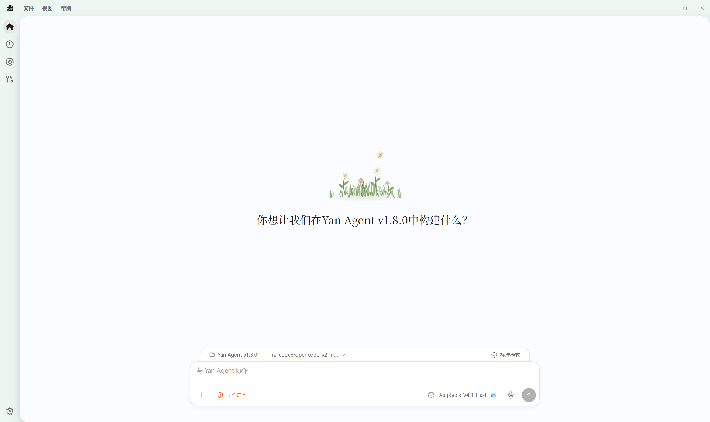

<div align="center">

# Yan Agent

### 使用智能体进行构建的最佳方式

**从理解项目到修改、执行与验收，把工程任务交给一个能动手的 AI 工作区。**

[中文](README.md) · [English](README.en.md)

[](https://github.com/ViaTumLab/Yan-Agent/releases)

[](LICENSE)

[下载 Windows 版](https://github.com/ViaTumLab/Yan-Agent/releases) · [版本发布](https://github.com/ViaTumLab/Yan-Agent/releases) · [问题反馈](https://github.com/ViaTumLab/Yan-Agent/issues) · [官方网站](https://yanagent.top)

</div>



Yan Agent 是一个开源的 Windows 桌面 AI 智能体。你提供目标、项目和可用的模型服务，它在真实工作区中读取文件、追踪问题、编辑代码、运行命令，并通过浏览器、测试和桌面工具验证结果。

v1.8.0 把运行时迁移到 **Yan Kernel V2**，并加入 Agent 模式、嵌套会话、动态工作流编排与定时任务。项目、对话、子代理、浏览器、文件差异和工具执行，仍然围绕同一个任务展开：你可以随时查看进度、追加要求、检查产物，把精力留给真正需要自己判断的环节。

## v1.8.0 更新要点

| 能力 | 说明 |
| --- | --- |
| Yan Kernel V2 | 私有 Node 内核，重写启动、取消、结束与进程清理；任务直接在工作区中读取、修改与验证。 |
| Agent 模式 | 标准、极简、创造、日常、无审查五种模式，可保存自定义 Agent，新建任务时切换。 |
| 嵌套会话 | 一条任务内最多创建 4 个子会话分别委派，支持人机协作与不同模型分工，由主会话统一验收。 |
| 动态工作流编排 | 按目标、成员、阶段、任务组织多阶段工作，依赖在上游验收后解锁，支持暂停与恢复。 |
| 定时任务 | 按每日或每周的计划，在独立会话中自动执行持续性任务。 |
| 系统标题栏 | 集成侧边栏开关、文件／视图／帮助菜单与窗口控制。 |
| 浏览器验收双模式 | 快速验收一次批量检查；严谨验收覆盖多视口、交互与前后帧对比。 |
| 工作过程呈现 | 用量按轮次更新，上下文组件与目标进度实时刷新，工具结束后输出自然正文。 |

## 你可以把哪些工作交给 Yan？

| 你的目标 | Yan 的工作方式 |
| --- | --- |
| 修复一个难以复现的错误 | 阅读项目与日志，追踪调用链，提出并实施修复，再运行相关测试。 |
| 在现有项目里开发新功能 | 理解项目约定，拆分前后端工作，修改代码并检查集成结果。 |
| 把设计变成可用页面 | 使用设计与前端工具实现页面，在浏览器中检查交互和不同屏幕尺寸。 |
| 审查一批代码变更 | 阅读 diff 与上下文，指出具体问题，回答审阅疑问，再按反馈继续修改。 |
| 整理桌面应用里的内容 | 在授权后操作 Windows 应用，结合应用快照理解当前界面。 |
| 接着推进一个长任务 | 查看已有进度和文件变化，调整计划、追加上下文，继续执行。 |
| 让任务按时自己跑 | 创建定时任务，在指定时间自动执行提醒、检查或持续性工作。 |

这些场景可以组合使用：同一个任务既可以改代码，也可以启动本地预览、检查网页、整理结果并交付文件。实际可用工具取决于已启用的插件、模型能力和你的授权。

## 高效处理你的工程任务

从深藏不露的错误、跨模块修改，到新功能开发，Yan 把工作放在实际项目中推进。工作区提供文件与工程上下文，终端用于执行命令和测试，审阅面板展示最后改了什么。

- **先理解项目：** 查找文件和符号，梳理模块关系，追踪实现路径。
- **在项目中实施：** 按需求修改文件、运行开发命令，并处理执行中的反馈。
- **用实际结果验收：** 结合测试、浏览器操作和界面截图检查成果。
- **随时参与：** 运行中追加引导或排队消息，看到方向偏差时及时纠正。

例如，你可以这样开始：

> 修复登录后刷新页面就退出的问题。先追踪前端会话恢复和后端认证逻辑，保留现有 UI。完成后验证登录、刷新、退出和错误密码四条路径，并告诉我改了哪些文件。

## 五种 Agent 模式，按任务选择工作方式

新建任务时，输入框上方的模式菜单决定这一条任务使用的系统提示词与工具范围。模式随任务保存，运行中的任务不会因为切换菜单而改变已有设定。


| 模式 | 适合什么任务 |
| --- | --- |
| 标准模式 | 完整开发环境，开放全部工具，默认模式。 |
| 极简模式 | 极少上下文与工具暴露，适合游乐场测试。 |
| 创造模式 | 创建插件、技能、宠物或自定义智能体，个性化定制 Yan Agent。 |
| 日常模式 | 日常聊天、联网搜索、生图与生视频；开发任务请切回标准模式。 |
| 无审查模式 | 无审查系统提示词，开放全部工具，责任由用户自担。 |

需要固定一套配置时，可以创建并保存**自定义 Agent**，它会出现在同一菜单中供后续任务选择。Agent 模式改变的是提示词与可用工具，读写、网络与审批边界仍由权限设置决定。

## 一条任务，四种协作方式

Yan 提供四种互补的分工方式，可以按任务复杂度组合使用。

### 嵌套会话

在一条任务内把工作拆成多个子任务，最多创建 **4 个子会话**分别委派。子会话可以继续人机对话，也可以为不同子会话选择不同模型，最后由你和主会话一同验收整体成果。


### 子代理

子代理由主代理按任务自行创建与命名，权限直接继承主代理，并发上限为 10。右侧子代理面板显示每个子代理的名称、当前动作与耗时；等待返回时显示数量，并支持取消已选子代理。子代理没有预设角色，职责由派发内容决定。

### 动态工作流编排

多阶段任务可以让主代理登记目标、成员、阶段与任务，再按依赖顺序推进。面板「构建工作流编排」列出每个阶段的任务与负责人，状态包括待开始、进行中、待验收、已通过、已完成、需处理、已中断与已暂停。


依赖任务只在上游被明确验收后解锁；每个任务提交后需要逐次验收——接受，或要求返工并附具体证据。写作用域用于协调任务边界，不授予额外权限。

### 外部桌面智能体

Yan 支持对接 **Codex、Claude** 等桌面智能体。通过智能体目录查看详情、检测本机程序、配置路径，再派发任务并回收结果。应用登录、工作目录信任和外部应用自身的审批由你掌握。

## 定时任务：让工作按时发生

定时任务让 Yan 在指定时间自动执行持续性工作。创建流程分为三页：**说明**写清每次要做的事，**发生于**选择工作区、每日或每周频率与时间，**模型选择**指定本任务使用的模型与强度。


- 每个定时任务对应一个独立会话，到点自动执行一次。
- 在任务会话里继续聊天属于人工追问，不会重复触发定时执行。
- 提醒类任务只输出一句提醒；需要事实、检查或动作的任务会实际执行并给出结果。

## 从文件差异到 PR，把结果看清楚

提交前需要知道的不只是“完成了”，还包括改动范围、实现理由和验证情况。

- 查看文件树与代码差异，检查实际变更。
- 在审阅中提出批注，把反馈交回任务继续处理。
- 结合 Git 分支、提交和 worktree 管理工程任务。
- 处理 PR 和 Issue，围绕代码变更进行审查与问答。
- 归档托管 worktree 时保存成果，之后按需恢复。


## 浏览器与电脑操控，让验收走出终端

### 内置浏览器

网页可以直接进入任务工作流。打开本地预览或在线页面，完成登录、检查表单、测试交互，并在宽屏和窄屏下验收。

浏览器验收提供两档工作程度：**快速**一次批量检查即可，遇到 3D／WebGL、登录、支付等高风险页面会要求你批准升级；**严谨**覆盖多视口、交互与前后帧对比。标签页支持复用与拖到独立窗口，另提供历史记录、下载列表、网页批注和 PDF 导出。


### Windows 应用操控

让 Yan 在授权范围内操作桌面应用。你可以管理始终允许的应用，查看已操控应用及其积累的使用经验，也可以将经验下载为 **Markdown 文件**，便于阅读、备份和分享。

### 应用快照

不方便描述界面时，直接把窗口交给 Yan 看。配置快捷键后捕获外部应用窗口，添加截图、应用信息和问题到聊天；也可以查看快照中的文本。

## 把工具、技能与服务接到同一处

Yan 的扩展系统由 **插件、智能体、技能和 MCP** 组成。你可以安装、配置、启停和管理扩展，让任务获得所需的专业方法与工具。


- **插件：** 安装专业能力，查看详情和使用示例，连接所需账号，并在「说明」右侧检查版本与更新。
- **技能：** 使用内置工作方法，导入其他 Agent 的技能目录，以链接或复制方式维护。
- **项目规则：** 将代码约定、构建方式和项目边界提供给智能体；全局偏好可通过自定义说明配置。
- **MCP：** 连接本地或远程工具服务，按需加载工具和上下文。

典型扩展包括 Figma、Canva、Playwright、Remotion 和 HyperFrames，覆盖设计、浏览器自动化与视频制作等工作。新插件 **Magpie-for-Yan-Agent** 可以把各类订阅接入 Yan Agent。

### 自带的 10 个服务

Yan 内置以下服务，不需要当作第三方 MCP 逐个安装；其中部分默认未连接，任务确实需要时才按需激活。

| 服务 | 主要职责 |
| --- | --- |
| Yan Skills | 技能与技能资源的查找、安装、读取和删除。 |
| Yan Built-in Browser | 控制右侧内置浏览器，用于网页阅读、交互与视觉验收。 |
| Yan Web | 已知 URL 的文本读取、静态资源落盘与页面资源。 |
| Yan Session | 经授权的跨任务／工作区交接、外部智能体协作与 Intelligent UI。 |
| Yan Continual Harness | 把重复失败与可复用策略排队，在本轮结束后做证据化演进。 |
| Yan Analysis | 仓库地图、符号大纲、调用树与 BM25 代码／历史检索。 |
| Yan Workspace | 任务级 git worktree 与 code_impact 反向依赖影响面检查。 |
| Yan MCP | 核对官方来源后安装、验证与移除 MCP 服务。 |
| Yan Plugin | 浏览、校验与安装 Yan 插件。 |
| Yan Provider | 探测服务商模型目录，写入连接并绑定文本／生图／生视频模型。 |

## 模型由你选择，任务可以各用所长

Yan 支持多连接和不同供应商的适配路径，包括 OpenAI、Anthropic、Gemini、DeepSeek、Qwen、GLM、Kimi 等。你可以根据任务选择模型，为嵌套会话单独指定模型，并管理上下文、推理和输出参数。

- **任务之间独立选模：** 不同任务可以使用不同模型。
- **一句话配置服务商：** 提供 Base URL、API Key 与模型名，由 Yan 探测模型目录并写入连接。
- **统一管理连接：** 配置服务地址、协议、API Key 和启用的模型。
- **多模态链路：** 配置文本、图像和视频服务，结合视觉上下文处理任务。
- **用量可见：** 用量组件按轮次更新，显示最近一次请求的上下文与用量估算。

模型列表、工具调用、上下文长度和媒体生成能力以实际服务为准。Yan Agent 开源使用，模型与第三方服务按各自规则计费。

## 不止于代码的日常工作体验

图片查看与编辑支持缩放、标注、文字和评论；语音输入与朗读让输入、阅读多一种选择。聊天支持重命名、置顶、归档、引用和导出，重要产物可以通过链接直接打开。

v1.8.0 还带来了新的系统标题栏、胶囊面板、开机动画、彩纸礼炮彩蛋、自动归档不活跃聊天与蓝点消息通知。你可以配置字体、字号、主题、壁纸、提示音和通知，让长时间工作更适合自己的习惯。记忆可以按会话独立开关，也可以在设置中统一管理。

### 离开电脑，继续管理任务

通过 **局域网 WebUI**，手机或另一台设备可以继续查看和管理桌面任务。两端需在同一局域网，运行 Yan 的电脑保持开机、联网和服务运行。

## 从第一条任务开始

1. **安装：** 从 [Releases](https://github.com/ViaTumLab/Yan-Agent/releases) 下载 Windows x64 安装包并启动应用。
2. **连接模型：** 在模型服务配置中添加服务地址、API Key 和对应协议，刷新并启用模型。
3. **选择工作区：** 打开项目目录，或从 Blank 聊天开始（Blank 支持完全磁盘写入，仍受沙盒、权限与审批约束）。
4. **选择 Agent 模式：** 一般开发用标准模式；聊天与生图生视频可选日常模式；需要极简上下文时选极简模式。
5. **描述交付目标：** 说明要做什么、保留什么、怎样算完成；按需添加附件、插件或技能。
6. **查看与引导：** 跟踪工具调用、子代理与工作流进度，处理审批，在需要时追加要求。
7. **审阅成果：** 检查文件变化、产物和验证结果，再决定提交或继续迭代。

建议从一个范围明确的任务开始，例如“定位这个报错并添加回归验证”。清楚的边界与验收条件能让协作更有效。

## 给开发者

### 从源码启动

使用 Windows x64、Node.js 和 npm：

```powershell
git clone https://github.com/ViaTumLab/Yan-Agent.git
cd Yan-Agent
npm ci
npm start
```

开发模式使用 `npm run dev`。部分能力需先准备运行组件：

| 命令 | 用途 |
| --- | --- |
| `npm run build:desktop-bridge` | 构建桌面桥接组件。 |
| `npm run build:cua-driver` | 准备电脑操控运行时。 |
| `npm run build:playwright` | 准备 Playwright 运行时。 |
| `npm test` | 运行项目单元测试。 |
| `npm run build` | 构建 Windows 安装包并执行相关打包检查。 |
| `npm run build:release` | 构建安装包与便携版。 |

构建产物位于 `dist/`。构建脚本可能下载组件，并需要对应系统工具；端到端测试可能依赖桌面应用、账号和模型服务。

### 代码入口

| 路径 | 内容 |
| --- | --- |
| `main.js` / `preload.js` | Electron 主进程入口与桌面桥接。 |
| `renderer/` | 聊天、设置、浏览器、审阅、工作流等界面。 |
| `lib/` | 模型适配、Yan Kernel V2、任务执行、工具、插件和数据管理。 |
| `lib/kernel-v2/` | 内核配置、工具策略、委派与动态工作流编排。 |
| `scripts/` | 构建、运行时准备与维护脚本。 |
| `test/` | 单元测试与端到端验证。 |

## 常见问题

**需要订阅指定模型吗？** 你可以配置自己选择的可用模型服务；供应商的账号、额度和费用由其自身管理。外部桌面智能体也需要相应应用与登录状态。

**数据是否全部留在本地？** 聊天、配置、工作区状态和经验在本地管理。调用模型或第三方工具时，所需内容会发送到对应服务；请依据项目的数据要求选择服务和工具。

**能在手机上运行吗？** 当前发布的安装包面向 Windows x64。手机可通过同一局域网的 WebUI 管理桌面任务，电脑仍承担执行工作。

**能否在开始修改前先看计划？** 可以使用计划方式，先讨论步骤、范围和验证策略，再推进实施；多阶段任务也可以直接交给动态工作流编排。

**嵌套会话和子代理有什么区别？** 嵌套会话在同一条任务内建立可继续对话的子会话，适合拆解并统一验收；子代理由主代理派发、权限继承，适合并行执行明确范围的子任务。

## 参与项目

欢迎通过 [Issues](https://github.com/ViaTumLab/Yan-Agent/issues) 分享使用反馈、复现问题和功能建议，也欢迎提交 Pull Request 改进实现、测试与文档。

报告问题时请附上应用版本、复现步骤、预期与实际结果，以及脱敏日志或截图。提交代码前运行相关检查，并说明改动范围和验证结果。

## 开源与致谢

Yan Agent 使用 [MIT License](LICENSE)。感谢为模型工具、桌面应用、浏览器自动化与开源生态贡献代码的开发者。第三方组件、技能与插件遵循各自许可，详见 [第三方致谢](lib/THIRD_PARTY_NOTICES.md) 和 [技能致谢](lib/skills/THIRD_PARTY_NOTICES.md)。

**开始使用 Yan Agent 进行构建。** [下载 v1.8.0](https://github.com/ViaTumLab/Yan-Agent/releases)

