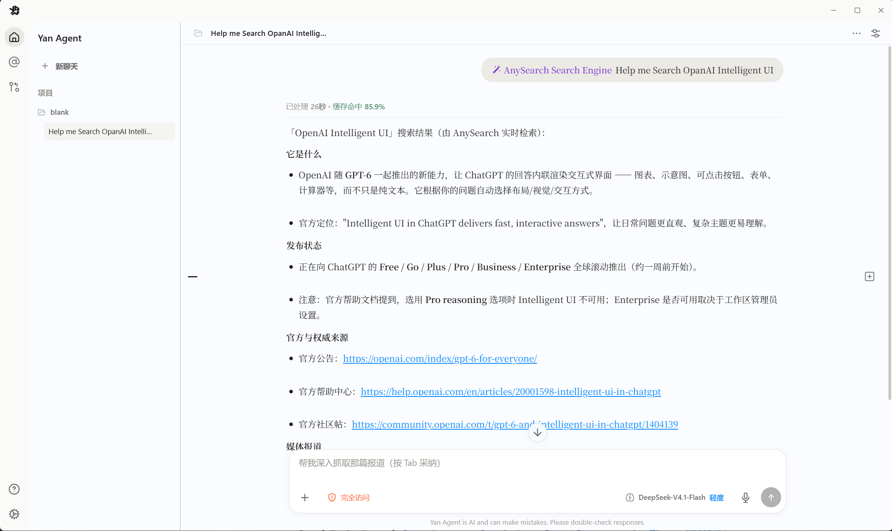
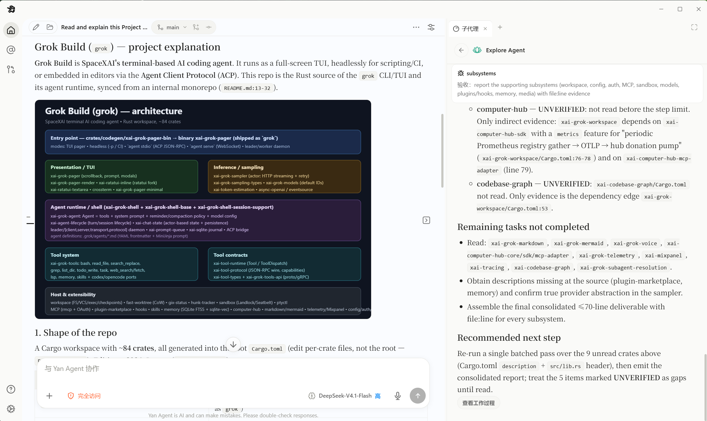
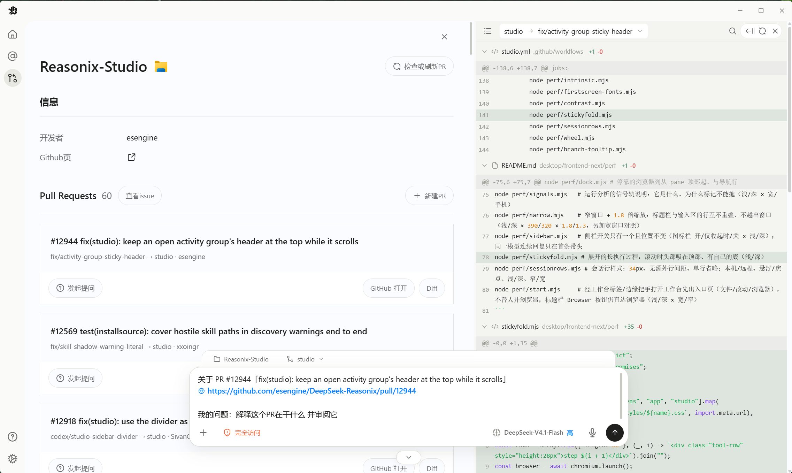
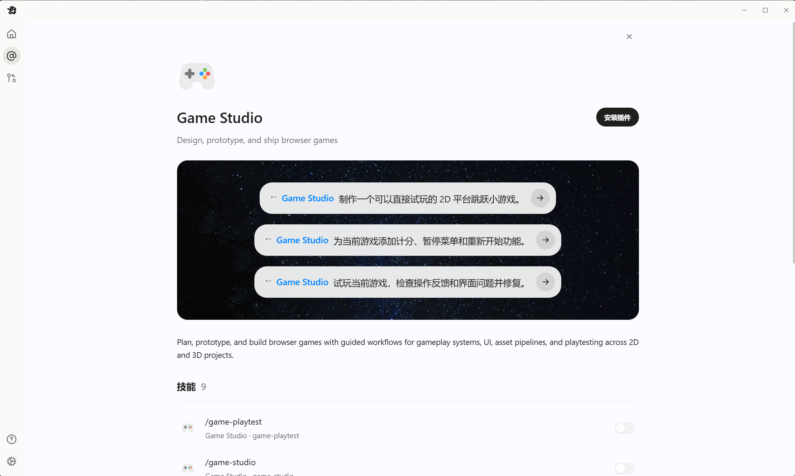

<div align="center">

# Yan Agent

### 使用智能体进行构建的最佳方式

**从理解项目到修改、执行与验收，把工程任务交给一个能动手的 AI 工作区。**

[中文](README.md) · [English](README.en.md)

[](https://github.com/ViaTumLab/Yan-Agent/releases)

[](LICENSE)

[下载 Windows 版](https://github.com/ViaTumLab/Yan-Agent/releases/download/v1.7.0/Yan.Agent.Setup.v1.7.0.exe) · [百度网盘 · 提取码 code](https://pan.baidu.com/s/1KZIFg29V7Ks89pvEWiY4mw?pwd=code) · [版本发布](https://github.com/ViaTumLab/Yan-Agent/releases) · [问题反馈](https://github.com/ViaTumLab/Yan-Agent/issues)

</div>



Yan Agent 是一个开源的 Windows 桌面 AI 智能体。你提供目标、项目和可用的模型服务，它在真实工作区中读取文件、追踪问题、编辑代码、运行命令，并通过浏览器、测试和桌面工具验证结果。

**项目、对话、子代理、浏览器、文件差异和工具执行，都围绕同一个任务展开。** 你可以随时查看进度、追加要求、检查产物，把精力留给真正需要自己判断的环节。

## 你可以把哪些工作交给 Yan？

| 你的目标 | Yan 的工作方式 |
| --- | --- |
| 修复一个难以复现的错误 | 阅读项目与日志，追踪调用链，提出并实施修复，再运行相关测试。 |
| 在现有项目里开发新功能 | 理解项目约定，拆分前后端工作，修改代码并检查集成结果。 |
| 把设计变成可用页面 | 使用设计与前端工具实现页面，在浏览器中检查交互和不同屏幕尺寸。 |
| 审查一批代码变更 | 阅读 diff 与上下文，指出具体问题，回答审阅疑问，再按反馈继续修改。 |
| 整理桌面应用里的内容 | 在授权后操作 Windows 应用，结合应用快照理解当前界面。 |
| 接着推进一个长任务 | 查看已有进度和文件变化，调整计划、追加上下文，继续执行。 |

这些场景可以组合使用：同一个任务既可以改代码，也可以启动本地预览、检查网页、整理结果并交付文件。实际可用工具取决于已启用的插件、模型能力和你的授权。

## 高效处理你的工程任务

从深藏不露的错误、跨模块修改，到新功能开发，Yan 把工作放在实际项目中推进。工作区提供文件与工程上下文，终端用于执行命令和测试，审阅面板展示最后改了什么。

- **先理解项目：** 查找文件和符号，梳理模块关系，追踪实现路径。
- **在项目中实施：** 按需求修改文件、运行开发命令，并处理执行中的反馈。
- **用实际结果验收：** 结合测试、浏览器操作和界面截图检查成果。
- **随时参与：** 运行中追加引导或排队消息，看到方向偏差时及时纠正。

例如，你可以这样开始：

> 修复登录后刷新页面就退出的问题。先追踪前端会话恢复和后端认证逻辑，保留现有 UI。完成后验证登录、刷新、退出和错误密码四条路径，并告诉我改了哪些文件。

## 多个子代理，并行推进一个目标

复杂任务可以拆给不同角色：有人探索代码，有人实施修改，有人检查结果。主代理负责组织工作、汇总证据并进行集成验证，你可以在子代理面板查看进度和输出。



| 子代理角色 | 适合承担的工作 |
| --- | --- |
| Explore | 查找文件、符号与项目事实。 |
| Review | 审阅实现，指出具体缺陷与风险。 |
| Research | 查阅文档与外部资料。 |
| Test | 执行测试和诊断。 |
| Build | 在明确范围内编写与验证代码。 |
| Mapper | 梳理仓库结构、模块边界和数据流。 |
| Tracer | 深入追踪调用链与算法路径。 |
| Reverser | 分析未知协议与行为，并验证解析结果。 |

不同角色可以选择不同模型，或跟随主模型。对于独立任务，也可以使用 worktree 隔离工作目录，减少并行修改之间的干扰。

> 并行检查前端登录流程和后端会话逻辑，分别给出证据。先汇总问题，再实施修复，最后运行集成验证。

## 让你已有的智能体加入工作

Yan 支持对接 **Codex、Claude 和 Reasonix Studio** 桌面智能体。通过智能体目录查看详情、检测本机程序、配置路径，再派发任务并回收结果。

可以将一个阶段交给外部智能体处理，在 Yan 中继续跟踪协作，结合返回的结果推进下一步。应用登录、工作目录信任和外部应用自身的审批由你掌握。

## 从文件差异到 PR，把结果看清楚

提交前需要知道的不只是“完成了”，还包括改动范围、实现理由和验证情况。

- 查看文件树与代码差异，检查实际变更。
- 在审阅中提出批注，把反馈交回任务继续处理。
- 结合 Git 分支、提交和 worktree 管理工程任务。
- 处理 PR 和 Issue，围绕代码变更进行审查与问答。
- 归档托管 worktree 时保存成果，之后按需恢复。



## 浏览器与电脑操控，让验收走出终端

### 内置浏览器

网页可以直接进入任务工作流。打开本地预览或在线页面，完成登录、检查表单、测试交互，并在宽屏和窄屏下验收。

浏览器还提供标签管理、历史记录、下载列表、网页批注和 PDF 导出。闲置后台标签支持冻结与恢复，兼顾工作连续性和资源占用。

### Windows 应用操控

让 Yan 在授权范围内操作桌面应用。你可以管理始终允许的应用，查看已操控应用及其积累的使用经验，也可以将经验下载为 **Markdown 文件**，便于阅读、备份和分享。

### 应用快照

不方便描述界面时，直接把窗口交给 Yan 看。配置快捷键后捕获外部应用窗口，添加截图、应用信息和问题到聊天；也可以查看快照中的文本。

## 把工具、技能与服务接到同一处

Yan 的扩展系统由 **插件、智能体、技能和 MCP** 组成。你可以安装、配置、启停和管理扩展，让任务获得所需的专业方法与工具。



- **插件：** 安装专业能力，查看详情和使用示例，连接所需账号，并控制单项技能开关。
- **技能：** 使用内置工作方法，导入其他 Agent 的技能目录，以链接或复制方式维护。
- **项目规则：** 将代码约定、构建方式和项目边界提供给智能体；全局偏好可通过自定义说明配置。
- **MCP：** 连接本地或远程工具服务，按需加载工具和上下文。

典型扩展包括 Figma、Canva、Playwright、Remotion 和 HyperFrames，覆盖设计、浏览器自动化与视频制作等工作。具体服务可能需要独立账号、运行环境和访问权限。

## 模型由你选择，任务可以各用所长

Yan 支持多连接和不同供应商的适配路径，包括 OpenAI、Anthropic、Gemini、DeepSeek、Qwen、GLM、Kimi 等。你可以根据任务选择模型，为子代理单独分配模型，并管理上下文、推理和输出参数。

- **任务之间独立选模：** 不同任务可以使用不同模型。
- **统一管理连接：** 配置服务地址、协议、API Key 和启用的模型。
- **多模态链路：** 配置文本、图像和视频服务，结合视觉上下文处理任务。
- **用量可见：** 查看 token、缓存和速度等信息，理解执行成本与性能。

模型列表、工具调用、上下文长度和媒体生成能力以实际服务为准。Yan Agent 开源使用，模型与第三方服务按各自规则计费。

## 不止于代码的日常工作体验

图片查看与编辑支持缩放、标注、文字和评论；语音输入与朗读让输入、阅读多一种选择。聊天支持重命名、置顶、归档、引用和导出，重要产物可以通过链接直接打开。

你还可以配置字体、字号、主题、壁纸、提示音和通知，让长时间工作更适合自己的习惯。记忆与使用经验可以在设置中管理。

### 离开电脑，继续管理任务

通过 **局域网 WebUI**，手机或另一台设备可以继续查看和管理桌面任务。两端需在同一局域网，运行 Yan 的电脑保持开机、联网和服务运行。

## 从第一条任务开始

1. **安装：** 下载上方 Windows x64 安装包并启动应用。
2. **连接模型：** 在模型服务配置中添加服务地址、API Key 和对应协议，刷新并启用模型。
3. **选择工作区：** 打开项目目录，或创建用于当前任务的工作空间。
4. **描述交付目标：** 说明要做什么、保留什么、怎样算完成；按需添加附件、插件或技能。
5. **查看与引导：** 跟踪工具调用和子代理进度，处理审批，在需要时追加要求。
6. **审阅成果：** 检查文件变化、产物和验证结果，再决定提交或继续迭代。

建议从一个范围明确的任务开始，例如“定位这个报错并添加回归验证”。清楚的边界与验收条件能让协作更有效。

## 给开发者

### 从源码启动

使用 Windows x64、Node.js 和 npm：

```powershell
git clone https://github.com/ViaTumLab/Yan-Agent.git
cd Yan-Agent
npm ci
npm start
```

开发模式使用 `npm run dev`。部分能力需先准备运行组件：

| 命令 | 用途 |
| --- | --- |
| `npm run build:desktop-bridge` | 构建桌面桥接组件。 |
| `npm run build:cua-driver` | 准备电脑操控运行时。 |
| `npm run build:playwright` | 准备 Playwright 运行时。 |
| `npm test` | 运行项目单元测试。 |
| `npm run build` | 构建 Windows 安装包并执行相关打包检查。 |
| `npm run build:release` | 构建安装包与便携版。 |

构建产物位于 `dist/`。构建脚本可能下载组件，并需要对应系统工具；端到端测试可能依赖桌面应用、账号和模型服务。

### 代码入口

| 路径 | 内容 |
| --- | --- |
| `main.js` / `preload.js` | Electron 主进程入口与桌面桥接。 |
| `renderer/` | 聊天、设置、浏览器、审阅等界面。 |
| `lib/` | 模型适配、任务执行、工具、插件和数据管理。 |
| `scripts/` | 构建、运行时准备与维护脚本。 |
| `test/` | 单元测试与端到端验证。 |

## 常见问题

**需要订阅指定模型吗？** 你可以配置自己选择的可用模型服务；供应商的账号、额度和费用由其自身管理。外部桌面智能体也需要相应应用与登录状态。

**数据是否全部留在本地？** 聊天、配置、工作区状态和经验在本地管理。调用模型或第三方工具时，所需内容会发送到对应服务；请依据项目的数据要求选择服务和工具。

**能在手机上运行吗？** 当前发布的安装包面向 Windows x64。手机可通过同一局域网的 WebUI 管理桌面任务，电脑仍承担执行工作。

**能否在开始修改前先看计划？** 可以使用计划方式，先讨论步骤、范围和验证策略，再推进实施。

## 参与项目

欢迎通过 [Issues](https://github.com/ViaTumLab/Yan-Agent/issues) 分享使用反馈、复现问题和功能建议，也欢迎提交 Pull Request 改进实现、测试与文档。

报告问题时请附上应用版本、复现步骤、预期与实际结果，以及脱敏日志或截图。提交代码前运行相关检查，并说明改动范围和验证结果。

## 开源与致谢

Yan Agent 使用 [MIT License](LICENSE)。感谢为模型工具、桌面应用、浏览器自动化与开源生态贡献代码的开发者。第三方组件、技能与插件遵循各自许可，详见 [第三方致谢](lib/THIRD_PARTY_NOTICES.md) 和 [技能致谢](lib/skills/THIRD_PARTY_NOTICES.md)。

**开始使用 Yan Agent 进行构建。** [下载 v1.7.0](https://github.com/ViaTumLab/Yan-Agent/releases/download/v1.7.0/Yan.Agent.Setup.v1.7.0.exe)
